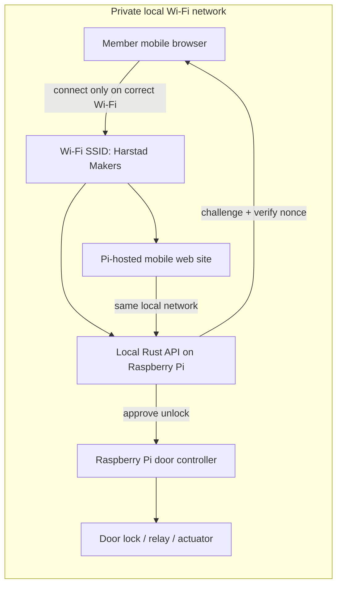
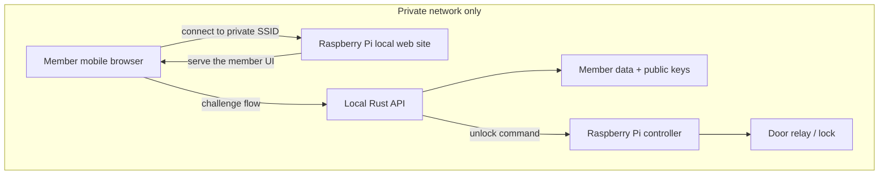
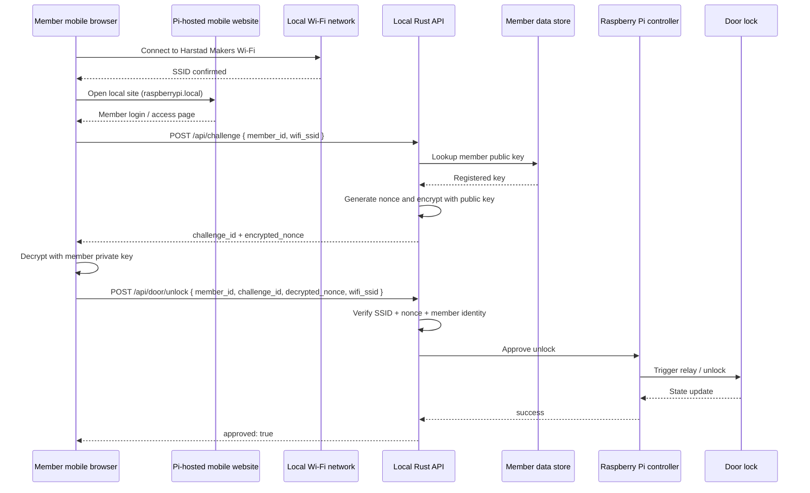
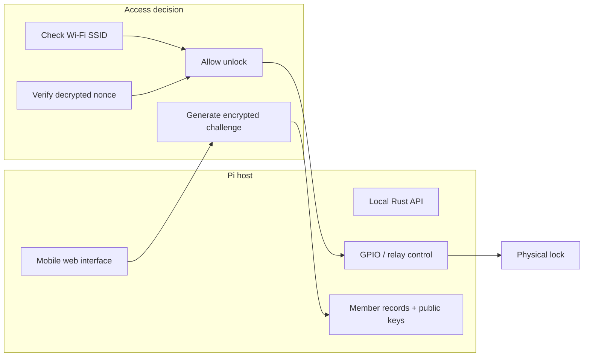
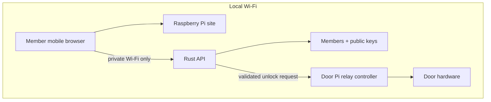
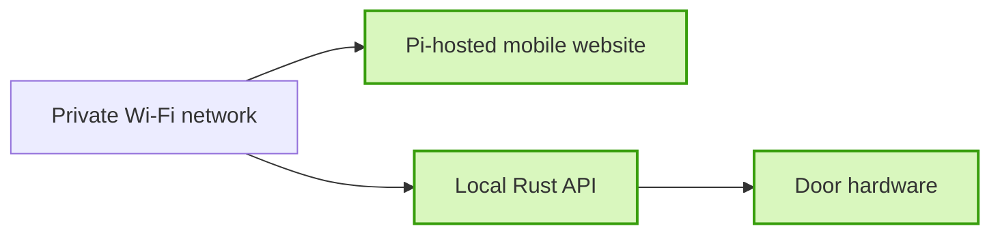

# Harstad Makers local-only architecture diagrams

## 1) High-level system overview

## 2) Local-only deployment

## 3) Member mobile web flow

## 4) Internal component responsibilities

## 5) Recommended local-only architecture

## 6) Security boundary

## Notes

- The member website runs locally on the Raspberry Pi.
- The mobile client must be on the correct private Wi‑Fi SSID before access is allowed.
- The Raspberry Pi is both the web host and the door controller for a local-only access system.
