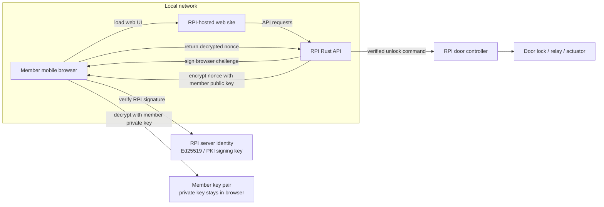
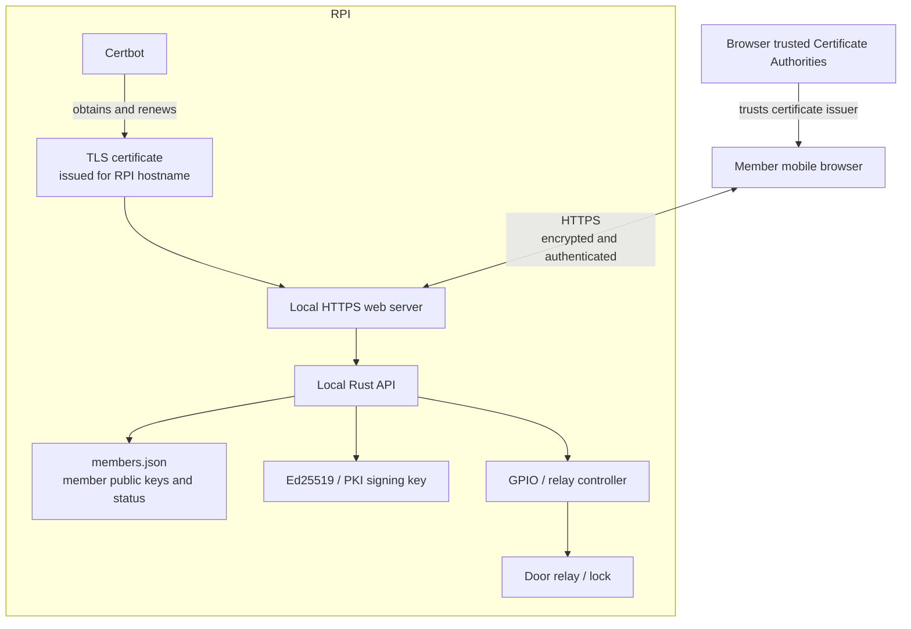
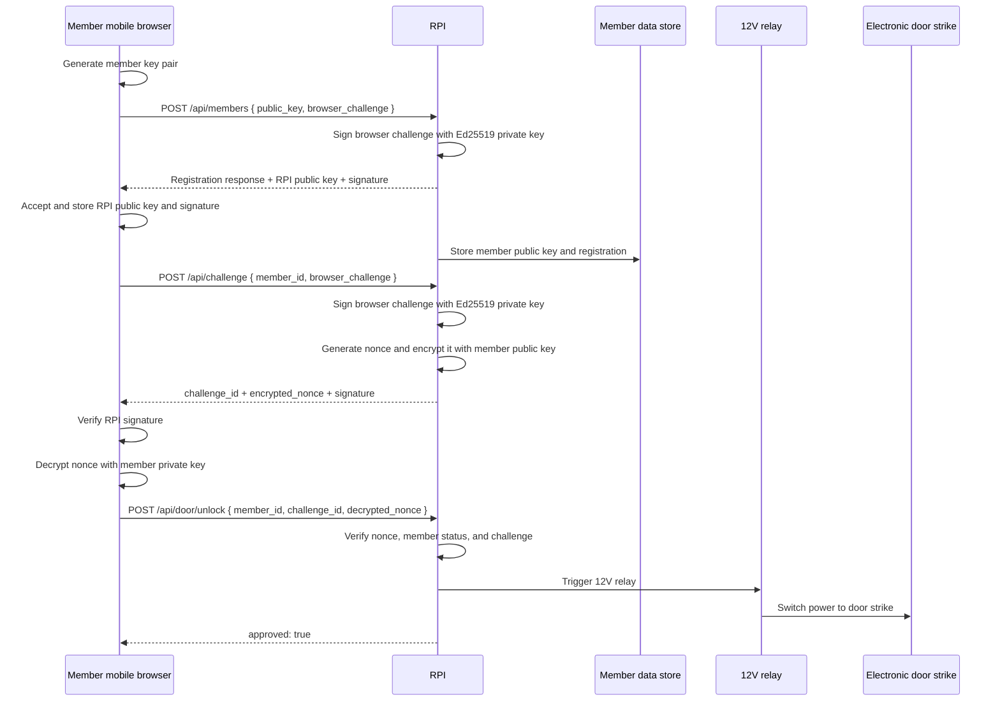
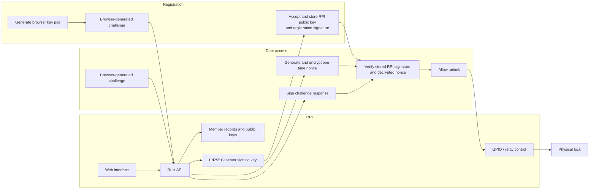
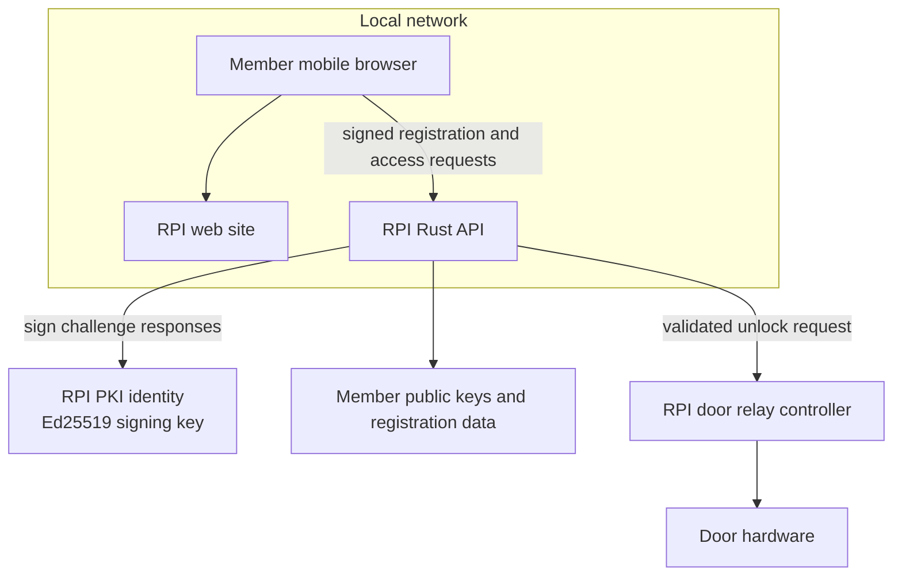
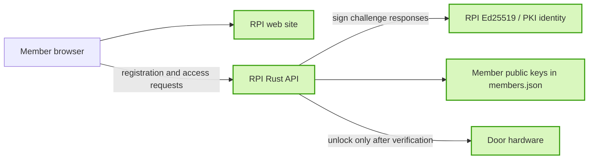

# Harstad Makers architecture diagrams

## 1) High-level system overview

## 2) Local deployment

- The website and API run locally on the RPI.
- Certbot obtains and renews the TLS certificate for the RPI hostname.
- The mobile browser trusts the RPI certificate through its built-in trusted Certificate Authorities.
- Browser-to-RPI communication uses HTTPS, providing encrypted transport and server authentication.

## 3) Member registration and unlock flow

## 4) Internal component responsibilities

## 5) Recommended architecture

## 6) Security boundary

## Notes
- The server is also called "RPI" in our documentation.
- The member website and API run on the server.
- On registration:
  - the client browser generates a public/private key pair.
  - the client stores its own private key and sends its public key to the server. The public key is not stored in the browser.
  - the server receives the public key and generates a member UUID and sends it along with its public key to the client.
  - the client stores three pieces of information; its private key, the servers public key and the member UUID.
- The door unlock server is only accessible on our local LAN/Wifi.
- The server authenticates its responses by signing browser-generated challenges with its Ed25519/PKI private key.
- The browser verifies the server signature using the trusted server public key before accepting registration or access responses.
- The member key pair proves possession of the registered browser key during the encrypted nonce challenge.
- The server is the trusted server and physically controls the door relay.
