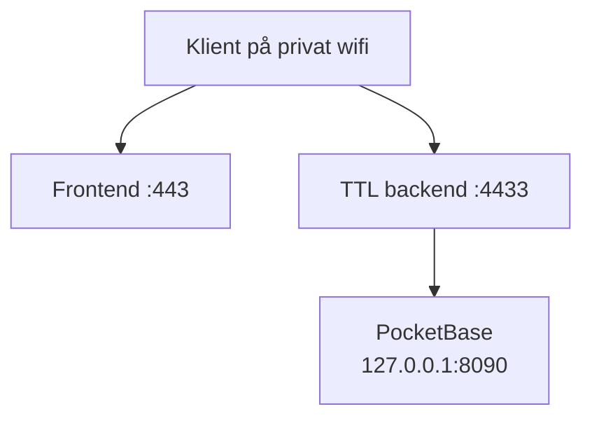
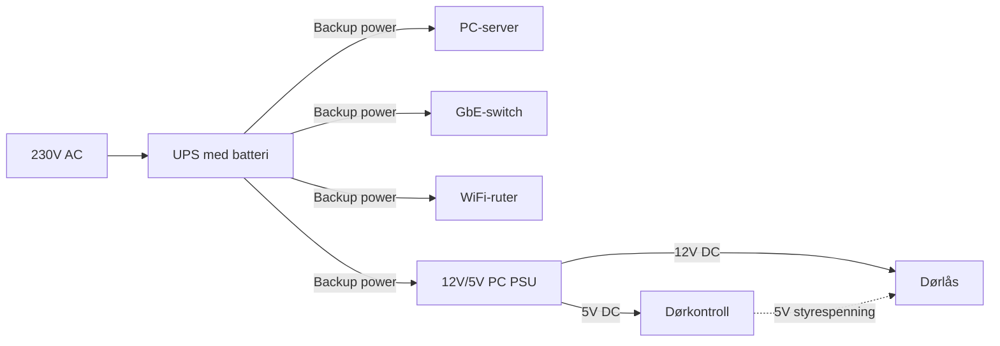

# Produksjonsoppsett

Dette dokumentet beskriver anbefalt produksjonsoppsett for TTL. PocketBase benyttes som database. PB skal kun være tilgjengelig lokalt på maskinen, mens backend eksponeres til det lokale nettverket gjennom den valgte frontend-/proxy-konfigurasjonen.

## Arkitektur



PocketBase skal ikke bindes til `0.0.0.0`. Backend kobler til PocketBase via loopback-adressen `http://127.0.0.1:8090`

## System-oppsett

Dette er oppsettet på Raspberry Pi 4.

### Start med Raspbian

1. Basic installasjon av Raspbian, med GUI, for Pocketbase.
2. Lag en adminkonto som du kan logge inn med for å sette opp resten.

### Sett opp serveren

1. Sett rett hostname, `sudo hostnamectl set-hostname mypi-server`
2. Lag adminbruker, `sudo adduser administrator`
3. Sett bruker til å benytte sudo, `sudo usermod -aG sudo,adm administrator`

### SSH nøkkelpar for serveren

1. Sett opp SSH nøkkelpar først; `ssh-keygen -t ed25519 -C "your_email@example.com"`. Husk at den **offentlige** nøkkelen sendes og lagres i nettleser for alle medlemmer. Man kan se den ved å inspisere localStorage, der vil epost-adressen vises som en del av serverens offentlige nøkkel.
2. Kopier nøkkelparet `id_ed25519` og `id_ed25519.pub` til `/srv/ttl-api/.ssh/`

### Opprett systembrukere

Opprett systembrukere for pocketbase, ttl-api og ttl-frontend

```bash
sudo adduser --system --group --shell /usr/sbin/nologin --home /srv/pocketbase svc-pocketbase
sudo adduser --system --group --shell /usr/sbin/nologin --home /srv/ttl-api svc-ttl-api
sudo adduser --system --group --shell /usr/sbin/nologin --home /srv/ttl-frontend svc-ttl-frontend
```

### Last ned repofiler

`git clone git@github.com:tplive/harstadmakers.git`

### Frontend: Installer Deno

1. Installer med `curl -fsSL https://deno.land/install.sh | sh -s -- --yes`.
2. Flytt filene

* `sudo mkdir -p /opt/deno`
* `sudo mv ~/.deno/bin/deno /opt/deno/`
* `sudo ln -sf /opt/deno/bin/deno /usr/local/bin/deno  # adjust if paths differ`

3. Gjør tilgengelig for svc-ttl-frontend brukeren:

* `sudo mkdir -p /srv/deno/.cache`
* `sudo chown -R svc-ttl-frontend:svc-ttl-frontend /srv/deno`

### Frontend: Installer api-frontend filene

Fra repoet, kopier `ttl/public/` til `/srv/ttl-frontend/`.

Frontend-tjenesten lytter over HTTPS på port 443 og bruker sertifikatene for
`ttl.harstadmakers.no`. Backend-tjenesten lytter over HTTPS på port 4433 og bruker samme SAN-sertifikat,
som dekker både `ttl.harstadmakers.no` og `ttl-api.harstadmakers.no`. Port 443 kan ikke
brukes av begge prosessene på samme IP-adresse uten en reverse proxy.

Frontend-sertifikatene som er oppgitt for denne installasjonen er:

```text
/home/thomas/.acme.sh/ttl.harstadmakers.no_ecc/fullchain.cer
/home/thomas/.acme.sh/ttl.harstadmakers.no_ecc/ttl.harstadmakers.no.key
```

Gi `svc-ttl-frontend` lesetilgang til sertifikatfilene.

### API: Installer api-backend filene

Fra repoet, Kopier `ttl/backend/configuration.json` til `/srv/ttl-api/`. Tjenesten leser
denne filen som standard fra arbeidskatalogen. En annen konfigurasjonsfil kan
angis med `ttl-api -c /path/to/configuration.json`.

Konfigurasjonen inneholder også stier til TLS-sertifikat og privat nøkkel for
backend. Sertifikatene kan utstedes og fornyes med `acme.sh`. Sørg for at
`svc-ttl-api` og `svc-ttl-frontend` kan lese de relevante sertifikatfilene.

Last ned releaseversjon (TODO) fra repoet `/srv/ttl-api`.

Alternativ: Kompilèr selv med cargo. Kopier da `target/release/ttl-api` til `/srv/ttl-api`.

### Discord-integrasjon

TTL-backend bruker en generell Discord-notifikasjonslayer som kan utvides til nye hendelser uten å endre app-arkitekturen. Konfigurasjonen støtter separate webhooks for admin- og access-flows:

* `discord_admin_webhook_url` → sender dørsignal, feil og Domeneshop-utløpsvarsler til `ttl-admin`-kanalen.
* `discord_access_webhook_url` → sender nye registreringer til `ttl-access`-kanalen.

TODO: Status på Domeneshop-token fornyelse varsles fra egen cron-jobb.
TODO: Status på sertifikatfornyelse varsles fra egen cron-jobb i et separat shell-script eller python program.

Dette er lagt inn i `ttl/backend/configuration.json` som valgfrie felter. Dersom webhook-URL-en er tom, sendes ingen melding.

### Installere Pocketbase

1. Last ned [Pocketbase 0.41.1 for Linux ARM64](https://ganigeorgiev.com/meta/pocketbase/pocketbase/download/v0.41.1/pocketbase_0.41.1_linux_arm64.zip). Senere kan man oppdatere med `pocketbase update`
1. Unzip og flytt pocketbase binærfilen til `/srv/pocketbase`.
1. Start Pocketbase manuelt med `cd /srv/pocketbase && sudo ./pocketbase serve`. Dette gir startup-URL med token for initiell innlogging. Klikk linken. Pocketbase åpnes i nettleser og lar deg registrere brukernavn og passord for **superuser**.
1. Database opprettes i `pb_data/`.
1. Gå til Settings, Import collections og importer `ttl/backend/pb_schema.json` fra dette repoet.
1. Opprett ny bruker i `users` collection for ttl-api. Gi brukeren lese og skrivetilgang til `members` og `door_events` collections.
1. Konfigurer brukernavn og passord i `configuration.json`.
1. Stopp Pocketbase manuell kjøring med Ctrl-C.
1. `sudo systemctl daemon-reload`
1. Start systemservice:

```bash
sudo systemctl enable --now pocketbase
systemctl status pocketbase   # verify it's running as the right user
ps -o user= -C pocketbase
```

### Servicedefinisjoner

1. Lag servicedefinisjoner for hver tjeneste (pocketbase, ttl-api, ttl-frontend) i hhv.
   * `/etc/systemd/system/pocketbase.service`
   * `/etc/systemd/system/ttl-api.service`
   * `/etc/systemd/system/ttl-frontend.service`

(Maler finnes i `ini_service_files/`)

## Ekstra herding av operativsystemet

1. Ekstra herding av operativsystemet:

```bash
sudo apt update && sudo apt full-upgrade -y
sudo apt install unattended-upgrades ufw fail2ban -y
sudo dpkg-reconfigure -plow unattended-upgrades
```

1. Etter å ha satt opp SSH nøkler på hosten;

```bash
# Firewall: only allow SSH (and any service ports you expose, e.g. 80/443)
sudo ufw default deny incoming
sudo ufw default allow outgoing
sudo ufw allow OpenSSH
sudo ufw allow 80,443/tcp   # if web servers must be reachable externally
sudo ufw enable
```

3. Sett opp SSH kun med nøkler (passordløst):

```bash
# SSH: key-only auth
sudo sed -i 's/^#\?PasswordAuthentication.*/PasswordAuthentication no/' /etc/ssh/sshd_config
sudo sed -i 's/^#\?PermitRootLogin.*/PermitRootLogin no/' /etc/ssh/sshd_config
sudo systemctl restart ssh
```

### Strømforsyning og backup



Alle kritiske enheter går via UPS. Det gir nettverksutstyr og servere kontinuerlig backup ved strømavbrudd.

UPS vil signalisere kontrollert shutdown til PC server, som både hindrer feil på server og sparer batteristrøm til dørlås og ruter.

## Systembrukere og mapper

Kjør PocketBase og backend med separate, dedikerte systembrukere:

```text
pocketbase       -> PocketBase og pb_data
ttl-backend      -> Rust-backend
```

Eksempel på produksjonsmapper:

```text
/opt/pocketbase/
  pocketbase
  pb_data/

/opt/ttl-backend/
  ttl-backend
```

PocketBase skal eie `pb_data/`. Backend skal ikke lese eller skrive direkte i PocketBase-databasen.

## PocketBase

Start PocketBase på loopback-adressen:

```bash
/opt/pocketbase/pocketbase serve \
  --http=127.0.0.1:8090
```

Eksempel på systemd-unit:

`/etc/systemd/system/pocketbase.service`

```ini
[Unit]
Description=PocketBase
After=network.target

[Service]
Type=simple
User=pocketbase
Group=pocketbase
WorkingDirectory=/opt/pocketbase
ExecStart=/opt/pocketbase/pocketbase serve --http=127.0.0.1:8090
Restart=on-failure
RestartSec=5

[Install]
WantedBy=multi-user.target
```

Sikre PocketBase-mappen slik at bare PocketBase-brukeren kan skrive til
`pb_data/`.

## Backend-miljøvariabler

Opprett en root-eid miljøfil utenfor Git-repositoriet:

```bash
sudo install -d -m 750 /etc/ttl-backend
sudoedit /etc/ttl-backend/backend.env
```

Innhold:

```ini
POCKETBASE_URL=http://127.0.0.1:8090
POCKETBASE_TOKEN=<server-side-token>
POCKETBASE_MEMBERS_COLLECTION=members
POCKETBASE_EVENTS_COLLECTION=door_events
```

Backend bruker tokenverdien direkte som `Authorization: <token>`. Bytt ut
`YOUR_POCKETBASE_TOKEN` i `configuration.json` med et gyldig PocketBase-token.
Tokenet må være et gyldig auth-token for en bruker i PocketBase. Backend sender
det som `Authorization: Bearer <token>`. Importer den oppdaterte
`pb_schema.json`, eller sett tilsvarende regler manuelt:
`@request.auth.id != ""` for list/view/create/update på `members`. For
`door_events` er list/view/create tilstrekkelig: dørhendelser behandles som
immutable, så backend oppdaterer ikke eksisterende hendelser og utfører ikke
DELETE-operasjoner. Backend trenger derfor ikke superbruker-token.

Beskytt miljøfilen:

```bash
sudo chown root:ttl-backend /etc/ttl-backend/backend.env
sudo chmod 640 /etc/ttl-backend/backend.env
```

Token må ikke legges i:

* Git
* prosjektets `.env`-filer
* frontend-kode
* README-filer
* shell-kommandoer som kan havne i historikken

## Backend-service

Bygg og installer backend applikasjonen med release-profil:

```bash
cargo build --profile release --manifest-path ttl/backend/Cargo.toml
sudo install -m 755 target/release/ttl-backend \
  /opt/ttl-backend/ttl-backend
```

Eksempel på systemd-unit:

`/etc/systemd/system/ttl-backend.service`

```ini
[Unit]
Description=TTL backend
Requires=pocketbase.service
After=pocketbase.service network-online.target
Wants=network-online.target

[Service]
Type=simple
User=ttl-backend
Group=ttl
WorkingDirectory=/opt/ttl-backend
EnvironmentFile=/etc/ttl-backend/backend.env
ExecStart=/opt/ttl-backend/ttl-backend
Restart=on-failure
RestartSec=5
StandardOutput=journal
StandardError=journal

[Install]
WantedBy=multi-user.target
```

`Requires=` og `After=` sørger for riktig tjenesteavhengighet. Backend har også fail-fast-adferd: den stopper dersom PocketBase ikke er tilgjengelig eller tokenet mangler. Backend forutsetter at collections og schema allerede er korrekt konfigurert; schema kontrolleres ikke ved oppstart. `Restart=on-failure` gjør at systemd prøver på nytt når PocketBase kommer opp igjen.

Aktiver tjenestene:

```bash
sudo systemctl daemon-reload
sudo systemctl enable --now pocketbase.service
sudo systemctl enable --now ttl-backend.service
```

Kontroller status og logger:

```bash
sudo systemctl status pocketbase.service
sudo systemctl status ttl-backend.service
journalctl -u pocketbase.service -f
journalctl -u ttl-backend.service -f
```

## PocketBase-schema

Backend forutsetter at schema allerede er korrekt konfigurert. Collections må eksistere før backend startes. Opprett collections med korrekt schema ved å importere filen `ttl/backend/pb_schema.json` fra git-repoet.

## Oppstart og oppdatering

Test PocketBase lokalt:

```bash
curl -i http://127.0.0.1:8090/api/health
```

Kontroller at PocketBase bare lytter på loopback:

```bash
ss -ltnp | grep 8090
```

Forventet lytteadresse er:

```text
127.0.0.1:8090
```

Etter oppdatering av backend applikasjonen:

```bash
sudo systemctl restart ttl-backend.service
sudo systemctl status ttl-backend.service
```

Etter endring av miljøfilen trengs ikke `daemon-reload`, men backend må
startes på nytt:

```bash
sudo systemctl restart ttl-backend.service
```

`daemon-reload` trengs dersom systemd-unit-filen er endret:

```bash
sudo systemctl daemon-reload
sudo systemctl restart ttl-backend.service
```

## Token-rotasjon

Ved rotasjon av PocketBase-token:

1. Opprett et nytt server-token i PocketBase.
2. Oppdater `/etc/ttl-backend/backend.env`.
3. Kontroller eierskap og filrettigheter.
4. Restart backend.
5. Kontroller logger og `/health`.

Ikke logg tokenet eller skriv det ut i feilmeldinger.

## Nettverk og sikkerhet

* Bruk `127.0.0.1` i `POCKETBASE_URL`, ikke maskinens LAN-adresse, siden trafikken går ukryptert, men kan ikke avlyttes fra LAN.
* Ikke eksponer port `8090` gjennom brannmur eller reverse proxy.
* Bruk HTTPS for klienttrafikk til frontend/backend i produksjon.
* Kjør PocketBase og backend som separate brukere.
* Ta sikkerhetskopi av PocketBase med innebygget backup-funksjonalitet. Lagre backup offsite.
* Hold PocketBase, operativsystem og Rust-binær oppdatert.
* Ikke inkluder hemmeligheter i repository, logger eller API-responser.

## Feilsøking

Hvis backend stopper ved oppstart:

```bash
journalctl -u ttl-backend.service -n 100 --no-pager
```

Vanlige årsaker:

* `POCKETBASE_URL` mangler eller peker feil.
* `POCKETBASE_TOKEN` mangler eller er utløpt.
* PocketBase kjører ikke.
* PocketBase lytter på en annen adresse eller port.
* `members` eller `door_events` mangler.
