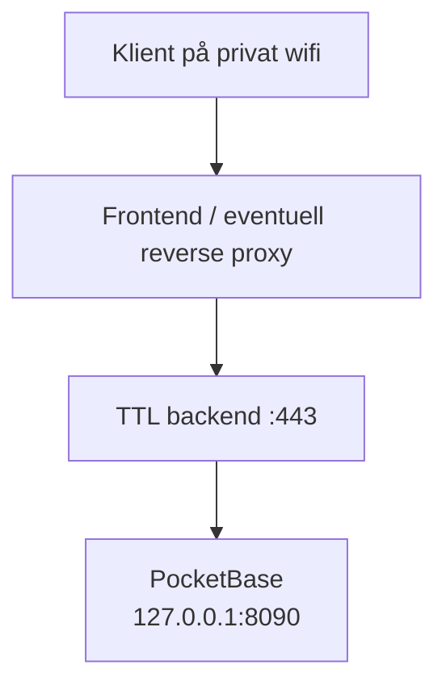

# Produksjonsoppsett

Dette dokumentet beskriver anbefalt produksjonsoppsett for TTL. PocketBase benyttes som database. PB skal kun være tilgjengelig lokalt på maskinen, mens backend eksponeres til det lokale nettverket gjennom den valgte frontend-/proxy-konfigurasjonen.

## Arkitektur



PocketBase skal ikke bindes til `0.0.0.0`. Backend kobler til PocketBase via loopback-adressen `http://127.0.0.1:8090`


## Systembrukere og mapper

Kjør PocketBase og backend med separate, dedikerte systembrukere:

```text
pocketbase       -> PocketBase og pb_data
ttl-backend      -> Rust-backend
```

Eksempel på produksjonsmapper:

```text
/opt/pocketbase/
  pocketbase
  pb_data/

/opt/ttl-backend/
  ttl-backend
```

PocketBase skal eie `pb_data/`. Backend skal ikke lese eller skrive direkte i PocketBase-databasen.

## PocketBase

Start PocketBase på loopback-adressen:

```bash
/opt/pocketbase/pocketbase serve \
  --http=127.0.0.1:8090
```

Eksempel på systemd-unit:

`/etc/systemd/system/pocketbase.service`

```ini
[Unit]
Description=PocketBase
After=network.target

[Service]
Type=simple
User=pocketbase
Group=pocketbase
WorkingDirectory=/opt/pocketbase
ExecStart=/opt/pocketbase/pocketbase serve --http=127.0.0.1:8090
Restart=on-failure
RestartSec=5

[Install]
WantedBy=multi-user.target
```

Sikre PocketBase-mappen slik at bare PocketBase-brukeren kan skrive til
`pb_data/`.

## Backend-miljøvariabler

Opprett en root-eid miljøfil utenfor Git-repositoriet:

```bash
sudo install -d -m 750 /etc/ttl-backend
sudoedit /etc/ttl-backend/backend.env
```

Innhold:

```ini
POCKETBASE_URL=http://127.0.0.1:8090
POCKETBASE_TOKEN=<server-side-token>
POCKETBASE_MEMBERS_COLLECTION=members
POCKETBASE_EVENTS_COLLECTION=door_events
```

Backend bruker tokenverdien direkte som `Authorization`-header.

Beskytt miljøfilen:

```bash
sudo chown root:ttl-backend /etc/ttl-backend/backend.env
sudo chmod 640 /etc/ttl-backend/backend.env
```

Token må ikke legges i:

- Git
- prosjektets `.env`-filer
- frontend-kode
- README-filer
- shell-kommandoer som kan havne i historikken

## Backend-service

Bygg og installer backend applikasjonen med release-profil:

```bash
cargo build --profile release --manifest-path ttl/backend/Cargo.toml
sudo install -m 755 target/release/ttl-backend \
  /opt/ttl-backend/ttl-backend
```

Eksempel på systemd-unit:

`/etc/systemd/system/ttl-backend.service`

```ini
[Unit]
Description=TTL backend
Requires=pocketbase.service
After=pocketbase.service network-online.target
Wants=network-online.target

[Service]
Type=simple
User=ttl-backend
Group=ttl
WorkingDirectory=/opt/ttl-backend
EnvironmentFile=/etc/ttl-backend/backend.env
ExecStart=/opt/ttl-backend/ttl-backend
Restart=on-failure
RestartSec=5
StandardOutput=journal
StandardError=journal

[Install]
WantedBy=multi-user.target
```

`Requires=` og `After=` sørger for riktig tjenesteavhengighet. Backend har også fail-fast-adferd: den stopper dersom PocketBase ikke er tilgjengelig, tokenet mangler, eller collections/schema ikke passer modellen. `Restart=on-failure` gjør at systemd prøver på nytt når PocketBase kommer opp igjen.

Aktiver tjenestene:

```bash
sudo systemctl daemon-reload
sudo systemctl enable --now pocketbase.service
sudo systemctl enable --now ttl-backend.service
```

Kontroller status og logger:

```bash
sudo systemctl status pocketbase.service
sudo systemctl status ttl-backend.service
journalctl -u pocketbase.service -f
journalctl -u ttl-backend.service -f
```

## PocketBase-schema

Backend validerer schema ved oppstart. Collections må eksistere før backend startes. Opprett collections med korrekt schema ved å importere filen `ttl/backend/pb-schema.json` fra git-repoet.

## Oppstart og oppdatering

Test PocketBase lokalt:

```bash
curl -i http://127.0.0.1:8090/api/health
```

Kontroller at PocketBase bare lytter på loopback:

```bash
ss -ltnp | grep 8090
```

Forventet lytteadresse er:

```text
127.0.0.1:8090
```

Etter oppdatering av backend applikasjonen:

```bash
sudo systemctl restart ttl-backend.service
sudo systemctl status ttl-backend.service
```

Etter endring av miljøfilen trengs ikke `daemon-reload`, men backend må
startes på nytt:

```bash
sudo systemctl restart ttl-backend.service
```

`daemon-reload` trengs dersom systemd-unit-filen er endret:

```bash
sudo systemctl daemon-reload
sudo systemctl restart ttl-backend.service
```

## Token-rotasjon

Ved rotasjon av PocketBase-token:

1. Opprett et nytt server-token i PocketBase.
2. Oppdater `/etc/ttl-backend/backend.env`.
3. Kontroller eierskap og filrettigheter.
4. Restart backend.
5. Kontroller logger og `/health`.

Ikke logg tokenet eller skriv det ut i feilmeldinger.

## Nettverk og sikkerhet

- Bruk `127.0.0.1` i `POCKETBASE_URL`, ikke maskinens LAN-adresse, siden trafikken går ukryptert, men kan ikke avlyttes fra LAN.
- Ikke eksponer port `8090` gjennom brannmur eller reverse proxy.
- Bruk HTTPS for klienttrafikk til frontend/backend i produksjon.
- Kjør PocketBase og backend som separate brukere.
- Ta sikkerhetskopi av PocketBase med innebygget backup-funksjonalitet. Lagre backup offsite.
- Hold PocketBase, operativsystem og Rust-binær oppdatert.
- Ikke inkluder hemmeligheter i repository, logger eller API-responser.

## Feilsøking

Hvis backend stopper ved oppstart:

```bash
journalctl -u ttl-backend.service -n 100 --no-pager
```

Vanlige årsaker:

- `POCKETBASE_URL` mangler eller peker feil.
- `POCKETBASE_TOKEN` mangler eller er utløpt.
- PocketBase kjører ikke.
- PocketBase lytter på en annen adresse eller port.
- `members` eller `door_events` mangler.
