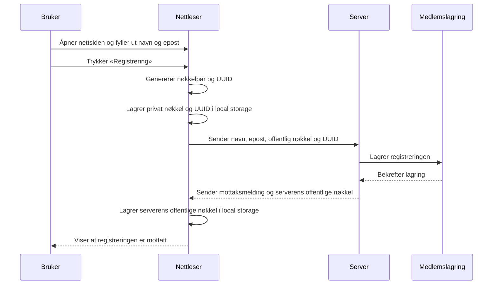
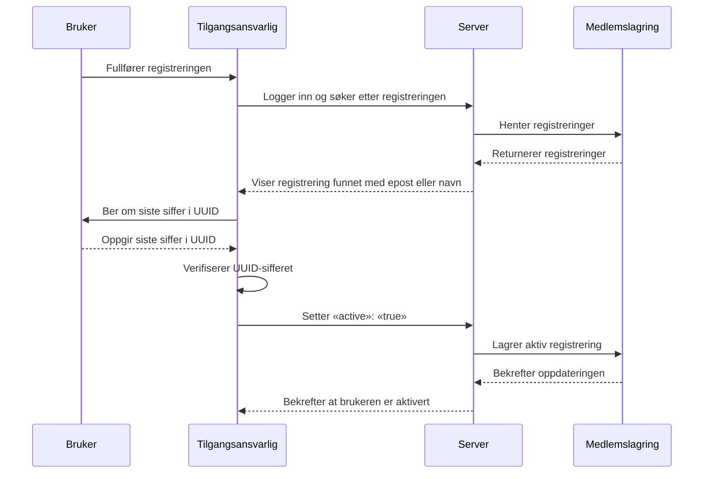
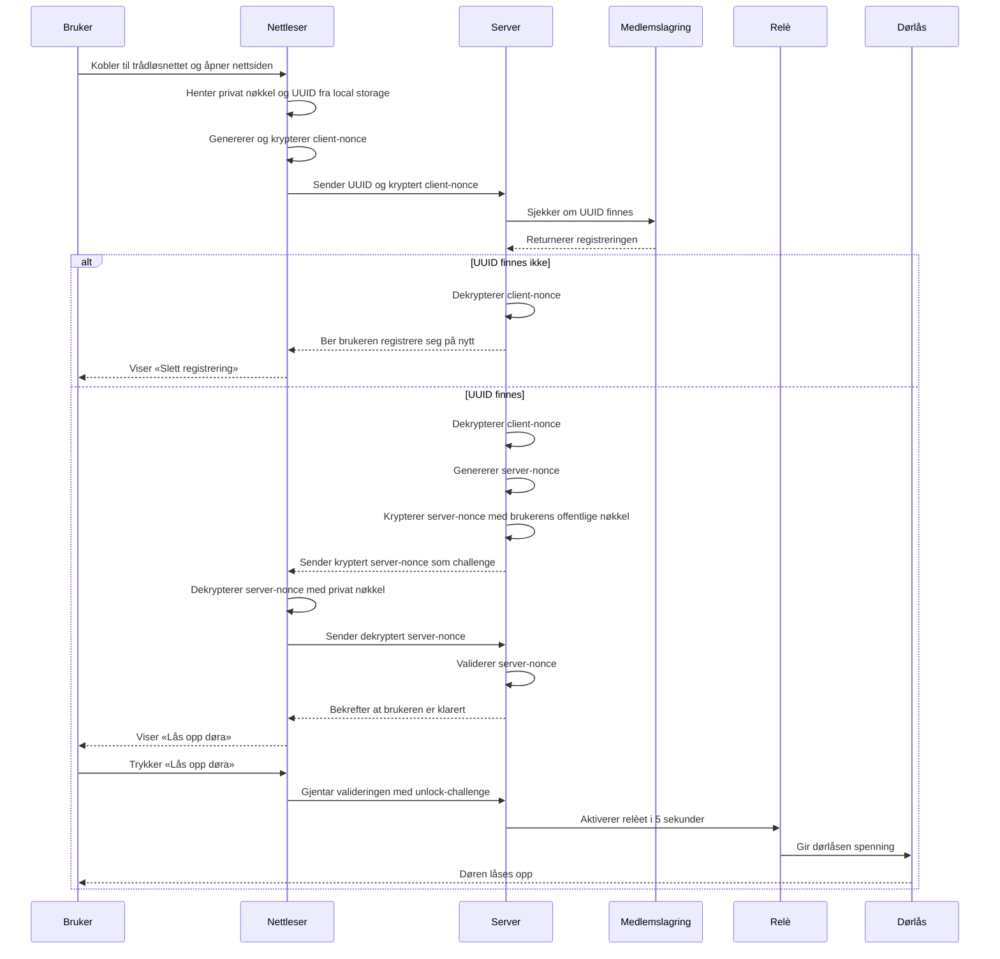
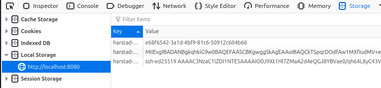

# Harstad Makers TTL (Tilgang Til Lokalene)

Dette er en webapplikasjon som på fiffig vis lar brukerne låse opp døren til lokalet vårt. Løsningen er meget sikker, benytter public key kryptering og er ikke eksponert til Internett. Den som vil bryte seg inn hos oss må enten være en _eksepsjonelt korttenkt, men begavet hacker_... eller en _smarting med et brekkjern for hånden_... Get it? 😂

Lokal tilgangskontroll for å komme inn i våre lokaler. Tilgangskontrollen vil etter hvert bli koblet opp til medlemsregisteret, og kun medlemmer vil kunne få tilgang.

## Hvordan virker det?

Den endelige designen er bevisst enkel:

1. Medlemmer må registrere seg før de kan bruke tilgangskontrollen. Dette gjøres èn gang, men må gjentas hvis man bytter telefon eller rensker nettleseren på telefonen, da tilgangskoden lagres der. En bruker kan ha flere nettlesere godkjent. Feks en mobil og en på sin pc.
1. Registreringen gjør at medlemmets tilgangsnøkkel lagres på server.
1. Når man vil låse opp døren, åpner man nettstedet fra mobilen sin mens man står på utsiden.
1. Nettleser og server utveksler litt data, og nettleseren må bevise at den har rett tilgangsnøkkel ved å dekryptere en utfordring fra server.
1. Når nettleser svarer med korrekt dekryptert utfordring, låses døra opp! 🤩

Teknologien som brukes kalles Public Key Encryption. Dersom du er nysgjerrig kan du f.eks. lese mer om dette her: <https://www.geeksforgeeks.org/computer-networks/public-key-encryption/>

## Hvilke hardware-komponenter inngår?

- En fysisk dørlås (eng. "electric door strike") på ytterdøra som kan aktiveres med å gi den 12V spenning.
- Et relè som lukker kretsen og gir dørlåsen spenning.
- En Raspberry Pi (her omtalt som "serveren") som er 
  - fysisk plassert inne i lokalene
  - fysisk koblet til dørlåsen via et relè
  - fysisk koblet til relèet via en GPIO-pinne
  - når korrekt opplåsing skjer, lukker den relèet ved å gi det 5V spenning, som aktiverer dørlåsen.
- En gammel (pent brukt) PC strømforsyning som gir 5V til serveren og relèet, og 12V til dørlåsen.
- En UPS (Uninterruptable Power Supply) som holder server, wifi og dørlås operative selv om strømmen skulle gå.
- Internett-ruteren, som muliggjør nedlasting av sertifikater for serveren. Mer om det lenger ned.
- Den opprinnelige Yale dørlåsen på døra, som "master lock":
  - **fortsatt fullt fungerende**
  - **helt uavhengig av denne løsningen**
  - **fortsatt styrt av huseier**

## Hvilken software inngår?
- Serveren leverer en nettside og et API for dørkontrollen.
- Serveren henter sertifikat for `ttl.harstadmakers.no` og `ttl-api.harstadmakers.no` fra Let's Encrypt via Certbot.
- Serveren kjører Nginx som TLS terminator. Se lenger ned i dokumentet.
- Serveren er konfigurert med IP-adresse på Harstad Makers sitt wifi-nettverk og er kun tilgjengelig når man er tilknyttet dette.
- Medlemmets PC eller mobiltelefon lagrer nøkler i nettleserens `localStorage` som enkelt kan inspiseres (se lenger ned).

## Teknisk Software-arkitektur

- Frontend: statisk HTML, CSS og JavaScript som serveres lokalt av serveren via en enkel webserver i lokalnettverket, over TLS med korrekt sertifikat.
- Backend: Rust + Axum-tjeneste for lagring av medlemmer, generering av utfordringer og autorisasjonskontroll.
- Persistens: JSON-baserte logger og medlemsdata i backend-data-mappen. **Kommer: En database som erstatter filene!**

Aktører:
- Serveren
- Nettleseren
- Brukeren
- Tilgangsansvarlig

### Registrering
- Tilgangsflyt:
  1. Brukeren kobler til wifi og åpner nettsiden.
  1. Brukeren taster inn navn og epost og trykker på "Registrering". Dette genererer en public/private nøkkelpar og en UUID.
  1. Privat nøkkel og UUID lagres i nettleserens local storage.
  1. Navn, epost, offentlig nøkkel og UUID sendes til serveren.
  1. Server svarer med mottaksmelding og sin public key som også lagres i nettleserens local storage.



### Aktivering

1. Brukeren har fullført registrering.
1. Tilgangsansvarlig logger seg på server og finner brukerens registrering ved epost/navn.
1. Tilgangsansvarlig verifiserer med å kontrollere siste siffer i brukerens registrerte UUID.
1. Tilgangsansvarlig setter "active": "true" på registreringen. **Kommer: et GUI for å administrere registreringene**



### Opplåsing av døra  
- Tilgangsflyt:
  1. Brukeren kobler til trådløsnettet og åpner nettsiden.
  1. Nettleseren sjekker local storage og finner at den er registrert.
  1. Nettleseren henter brukerens private nøkkel og UUID fra local storage.
  1. Nettleseren genererer en client-nonce som den krypterer med serverens public key og sender denne sammen med UUID til serveren og ber om en `registration-challenge`.
  1. Server sjekker om tilsendt UUID finnes i databasen.
  1. Dersom den ikke finnes<sup>1</sup>,
     - serveren dekrypterer client-nonce og returnerer den som bevis på at den er riktig server.
     - serveren gir beskjed til nettleseren om at brukeren må registrere seg.
     - nettleseren viser brukeren en knapp for "Slett registrering", som vil fjerne alle relevante verdier fra local storage i nettleseren og nullstille nettleseren.
  1. Dersom den finnes, 
     - serveren dekrypterer client-nonce og returnerer den som bevis på at den er riktig server.
     - genererer serveren en server-nonce som den krypterer med brukerens registrerte public key og 
     - sender kryptert server-nonce til nettleser som challenge.
  1. Nettleseren dekrypterer server-nonce med brukerens private nøkkel og sender dekryptert verdi tilbake til server som bevis på at den er den riktige nettleseren.
  1. Serveren validerer dekryptert server-nonce og gir melding tilbake til nettleseren om at brukeren er klarert for å låse opp døra.
  1. Brukeren ser nå en "Lås opp døra" knapp i nettleseren.
  1. Når bruker trykker på "Lås opp døra", gjentas stegene over for ny validering, men denne gang som en `unlock-challenge`.
  1. Server aktiverer relèet som åpner dørlåsen i 5 sekunder (konfigurerbart).



<sup>1: Dersom den ikke finnes har den kanskje aldri eksistert der, eller rydderutinen har slettet den. Uansett må bruker registrere seg på nytt.</sup>

## Sikkerhetsmodell

Noen nøkkelpunkter som gjør løsningen svært sikker og robust:

* Nettleser genererer og lagrer sin egen private nøkkel, som aldri forlater nettleseren.
* Server genererer og lagrer sin egen private nøkkel, som aldri forlater serveren.
* Nettleser representerer sin identitet med å sende over sin offentlige nøkkel til serveren ved registrering.
* Server representerer sin identitet med å sende over sin offentlige nøkkel til nettleseren ved registrering.
* Nettleser lagrer ikke selv sin offentlige nøkkel, men kan bevise sin identitet ved å dekryptere nonce sendt fra server.
* Server kan bevise sin identitet ved å dekryptere nonce sendt fra nettleser.
* Trafikk mellom nettleser på mobil og server er kryptert over HTTPS.
* Løsningen er ikke eksponert på Internett, brukeren må være tilknyttet lokalnettverket.
* Etter registrering må en administrator flagge registreringen som aktiv før brukeren kan låse opp døren.

### Nettleser

Server frontend og backend har begge TLS-sertifikater utstedt fra Let's Encrypt. Disse sikrer at nettleser validerer serveren korrekt, og vil gi sertifikat-feilmelding dersom en man-in-the-middle forsøker å lure brukeren.

Bruker fyller kun ut (for)navn og epost i nettleser. Nettleseren genererer en UUID og et nøkkelpar (privat og offentlig nøkkel). **Kun UUID og privat nøkkel** lagres i nettleseren. **Offentlig nøkkel sendes til server** som lagrer denne sammen med navn, epost, tidsstempel.

Man kan enkelt inspisere data som er lagret i nettleser, via F12 Developer Tools. Se under Storage, navn på server (enten localhost:8088, eller det faktiske navnet, ettersom.)


I teorien kan en angriper (MiTM) sende over javascript som forbigår server-sjekken, og lurer brukeren til å oppgi sitt navn og epost-adresse. Og sikkert lure fra dem kontonummer og fødselsnummer og hva det skal være. Sannsynligheten er lav. Og dette vil ikke la angriper åpne døren.

### API

Ved forespørsel fra nettleser genererer backend en nonce og krypterer den med medlemmets offentlige nøkkel. Den sender kryptert nonce til klienten. Nettleseren  dekrypterer nonce med den private nøkkelen og sender klarteksten tilbake for verifisering. Når klarteksten matcher lagret nonce, godkjenner backend døråpning. Brukeren ber nå om å få åpnet døren, og dette trigger dørlåsen.

Backend har en forhåndsgenerert Ed25519 SSH-nøkkel i `~/.ssh/id_ed25519` og en offentlig nøkkel i `~/.ssh/id_ed25519.pub`. Den offentlige


- Certbot obtains and renews the TLS certificate for the RPI hostname.
- The mobile browser trusts the RPI certificate through its built-in trusted Certificate Authorities.
- Browser-to-RPI communication uses HTTPS, providing encrypted transport and server authentication.

## Let's Encrypt certbot for frontend og backend

Let's Encrypt verifiserer at man kontrollerer domenet, og utsteder sertifikater som verifiseres av nettleser.
Sertifikatet inneholder ikke IP-adresse, så man kan (via DHCP) publisere lokale DNS-oppslag som gir lokale IP-adresser for serveren.

I følge dokumentasjonen til [Let's Encrypt](https://letsencrypt.org/docs/challenge-types/) er det ulike typer challenge som kan benyttes for å automatisere sertifikat-utstedelse.

Registrar og DNS leverandør må støtte "DNS-01 challenge" for at sertifikatene skal kunne automatiseres. Vi har verifisert at vår leverandør gjør det. Da konfigurerer man en certbot (feks. [acme.sh](https://github.com/acmesh-official/acme.sh/) med token og secret for DNS-leverandøren, og så publiserer serveren en DNS TXT record som Let's Encrypt bruker som bevis på at man kontrollerer domenet.

Alternativ: HTTP-01 challenge - dette krever at port 80 er åpent inn til serveren, og publiserer en tekstfil ut på Internett. Brukes dersom man ikke kommer i mål med DNS-01.

### Hvordan sørge for at TLS-sertifikatene kan utstedes automatisk

Vi bruker to DNS-navn:

- `ttl.harstadmakers.no` → frontend
- `ttl-api.harstadmakers.no` → backend

Klientene på vårt wifi-nettverk har fått konfigurasjon med lokal DNS server som holder en stub-sone for harstadmakers.no, og videreformidler alle andre oppslag til harstadmakers.no som den ikke kjenner til.

I denne DNS-serveren peker vi disse navnene til de lokale IP-adressene til server, for eksempel:

```text
ttl.harstadmakers.no      -> 192.168.1.50
ttl-api.harstadmakers.no  -> 192.168.1.50
```

Dette gjør at medlemmer på det lokale nettverket går til:

```text
https://ttl.harstadmakers.no
https://ttl-api.harstadmakers.no
```

som om de var tilgjengelige på Internett.

### Nginx som TLS-terminator (ved alternativ løsning HTTP-01 challenge)

På server kjører vi Nginx og konfigurerer den som reverse proxy til frontend og backend.

Det eneste som skal være åpent mot Internett er port 80 for Let's Encrypt HTTP-01 challenge. Alt annet skal blokkeres av ruteren/firewallen og være utilgjengelig fra Internett.

Eksempel:

```nginx
# Port 80 er kun åpent for ACME challenge.
# Ingen andre tjenester skal være publisert direkte mot Internett.
server {
    listen 80;
    server_name ttl.harstadmakers.no;

    location /.well-known/acme-challenge/ {
        root /var/www/letsencrypt;
    }

    return 301 https://$host$request_uri;
}

server {
    listen 443 ssl;
    server_name ttl.harstadmakers.no;

    ssl_certificate /etc/letsencrypt/live/ttl.harstadmakers.no/fullchain.pem;
    ssl_certificate_key /etc/letsencrypt/live/ttl.harstadmakers.no/privkey.pem;

    location / {
        proxy_pass http://127.0.0.1:8088;
        proxy_set_header Host $host;
        proxy_set_header X-Forwarded-For $proxy_add_x_forwarded_for;
        proxy_set_header X-Forwarded-Proto https;
    }
}

server {
    listen 80;
    server_name ttl-api.harstadmakers.no;

    location /.well-known/acme-challenge/ {
        root /var/www/letsencrypt;
    }

    return 301 https://$host$request_uri;
}

server {
    listen 443 ssl;
    server_name ttl-api.harstadmakers.no;

    ssl_certificate /etc/letsencrypt/live/ttl-api.harstadmakers.no/fullchain.pem;
    ssl_certificate_key /etc/letsencrypt/live/ttl-api.harstadmakers.no/privkey.pem;

    location / {
        proxy_pass http://127.0.0.1:3000;
        proxy_set_header Host $host;
        proxy_set_header X-Forwarded-For $proxy_add_x_forwarded_for;
        proxy_set_header X-Forwarded-Proto https;
    }
}
```

### ACME / certbot

Installer Certbot:

```bash
sudo apt update
sudo apt install -y certbot python3-certbot-nginx
```

Hent sertifikatene:

```bash
sudo certbot --nginx -d ttl.harstadmakers.no -d ttl-api.harstadmakers.no
```
